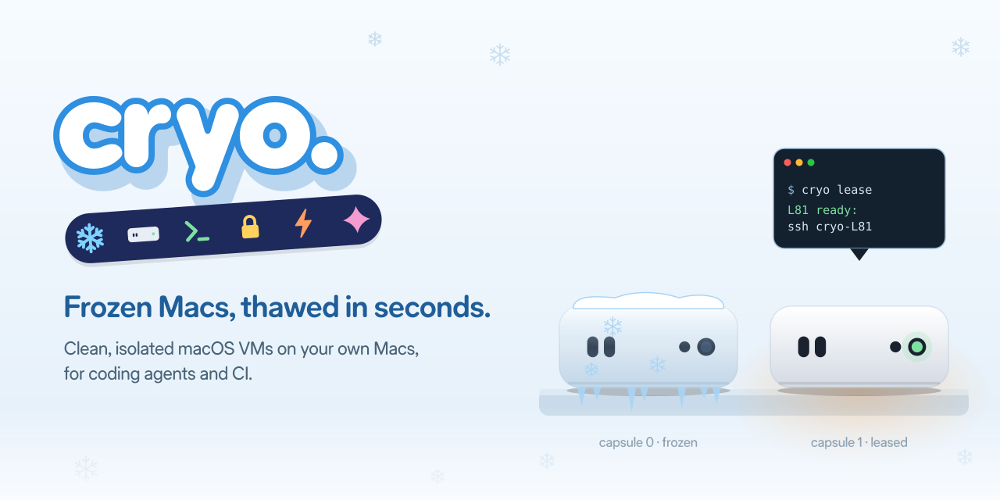

<picture>
  <source media="(prefers-color-scheme: dark)" srcset="assets/hero-dark.svg">
  
</picture>

# Cryo

Cryo turns the Macs you already own into a pool of clean,
isolated macOS VMs for coding agents and CI. Each VM waits as saved machine state on disk, and is
restored and handed out the moment someone asks for one. When the lease ends, the VM is thrown away
and a fresh one is thawed in its place.

```sh
cryo lease            # L81 ready: ssh cryo-L81
ssh cryo-L81 'xcodebuild test ...'
cryo release L81      # gone; a clean one is already thawing
```

## Contents

- [Why](#why)
- [Requirements](#requirements)
- [Install](#install)
- [Quick start](#quick-start)
- [For coding agents](#for-coding-agents)
- [CI](#ci)
- [Building](#building)
- [Docs](docs/README.md)
- [License](#license)

## Why

Running agents against Apple-platform work (Xcode, the Simulator, signing) on your own Mac puts
your keychain and SSH keys within reach of a program that runs commands unattended, and five agents
on five tasks collide. Cryo gives each agent its own disposable Mac instead:

- **Thaw, don't boot.** Capsules are restored from saved state, not booted, so a lease is ready over
  SSH in well under a second.
- **Isolated.** Each capsule has its own network, fenced off from the host, the LAN and the other
  capsule. Nothing carries over from one lease to the next.
- **Leases.** A capsule belongs to one client until it is released or its lease expires, so a
  crashed agent can't hold a Mac forever. When every capsule is busy, requests queue.
- **Golden images.** `cryo image build` installs macOS, Xcode and the Simulator runtimes into an
  image once; every capsule thaws from it.
- **Agent-native.** A CLI, an HTTP API, an MCP server and an agent skill.

Apple's Virtualization framework runs at most two macOS VMs per Mac, so each Mac (a **bay**) holds
two **capsules**.

## Requirements

- A Mac with Apple silicon and macOS 27 (host and guest). macOS 26 and earlier are not supported:
  Cryo uses Virtualization APIs that are new in macOS 27.
- 150 GB free disk (`cryo doctor` checks it) and 20 GB of RAM for two 8 GB capsules (or set `capsules = 1`).
- The Mac stays logged in and unlocked while the bay runs (the bay is a LaunchAgent in your session).

## Install

```sh
brew install rizwankce/tap/cryo
cryo bay install      # LaunchAgent + firewall rules for the capsules; asks for sudo once
```

Or from a checkout: `scripts/install.sh` builds `cryo`, signs it, installs it to `~/.cryo/bin` and
runs `cryo bay install`.

## Quick start

```sh
cryo doctor --fix           # sleep, automatic updates, Spotlight; the hints cover the rest
cryo image build --xcode    # build a golden image with Xcode
cryo image use <digest>     # freeze both capsules from it; the bay comes up on it
cryo setup                  # once: adds `Include ~/.cryo/ssh_config` to ~/.ssh/config
cryo lease --folder ./app   # a clean VM with ./app shared in
```

`cryo status` shows the bay, its capsules and the queue. `cryo ls` lists your leases.

## For coding agents

```sh
claude mcp add cryo -- cryo mcp     # or any MCP client: command `cryo`, args ["mcp"]
```

The MCP server offers `lease_mac`, `run`, `copy_in`, `copy_out`, `release_mac` and `status`, and
renews its leases itself. [skills/cryo/SKILL.md](skills/cryo/SKILL.md) teaches an agent how to use
them.

## CI

[cryo-ci](https://github.com/rizwankce/cryo-ci) runs GitHub Actions jobs on capsules: each job gets
a fresh VM. `cryo ci …` runs it once it is installed.

## Building

```sh
swift build
swift test
swift format lint --strict --recursive Sources Tests Package.swift   # CI runs this, plus shellcheck
```

The bay needs macOS 27 and Xcode 27. The CLI, client and MCP server also build on Linux, so an
agent on Linux can lease from a bay started with `cryo bay start --listen :7477`
(`CRYO_URL`, `CRYO_TOKEN`).

## License

Apache-2.0. See [LICENSE](LICENSE).
